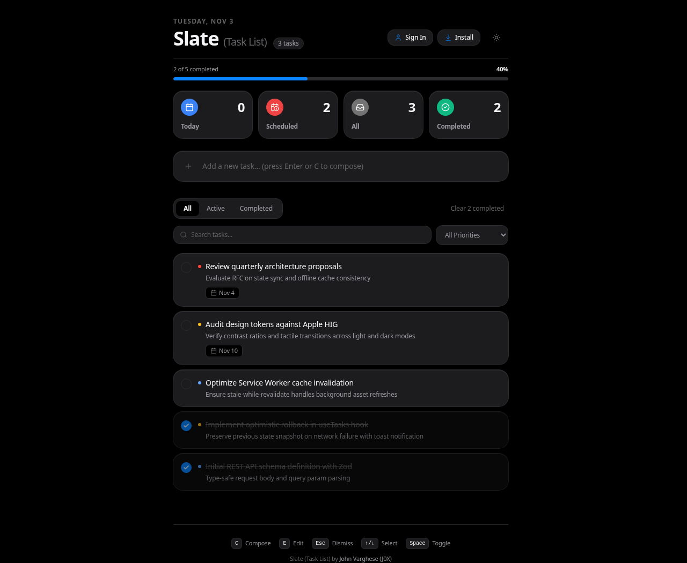
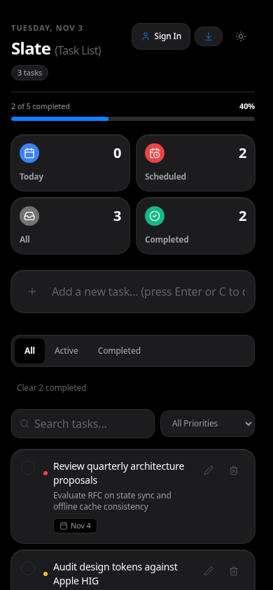
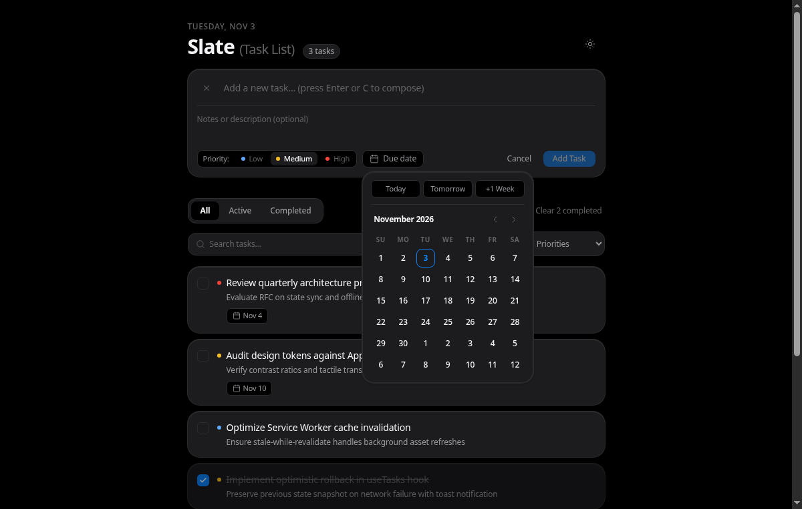
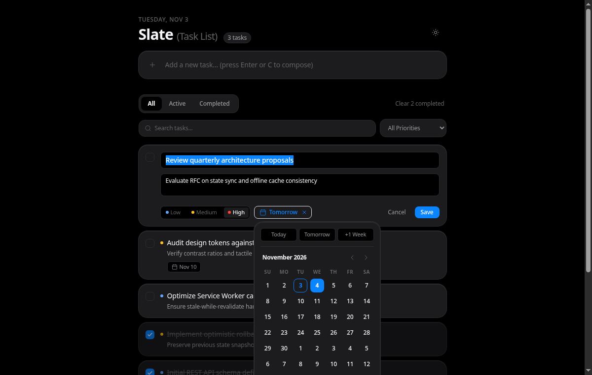

<p align="center">
  
</p>

<h1 align="center">Slate</h1>

<p align="center">
  <strong>A simple, polished task list application where users can add, edit, delete, and mark tasks as complete.</strong><br>
  Offline-first on-device buffer, zero-friction sync, and instant single-key flow.
</p>

<p align="center">
  
  
  
  
  
  
  
</p>

<p align="center">
  
</p>

---

## Why Slate?

Most task tools are bloated web apps that take seconds to load, hide actions behind nested menus, and break the moment your internet drops.

Slate is built for makers who prioritize speed, typography, and keyboard flow:
- **Instant startup**: Statically served SPA with zero empty-state flicker.
- **Keyboard-first speed**: Tap `C` to compose, `E` to edit, `Space` to check off. Keep your hands on the keyboard.
- **Offline-first reliability**: Changes persist instantly to local storage (`slate_cached_tasks`). If the network or server goes down, operations buffer locally and sync automatically when connectivity returns.
- **Guest mode**: Jump straight in with on-device local storage. No account required.
- **Multi-tenant cloud sync**: Sign in to sync across Mac, phone, and browser with isolated tenant workspaces.

---

## Screenshots

<p align="center">
  
  &nbsp;&nbsp;
  
</p>

<p align="center">
  
</p>

---

## Features

- **Tactile Inputs**: Custom 18x18px checkbox controls with 150ms spring feedback and 44px mobile touch targets.
- **Inline Composer & Quick Edit**: Inline expander for notes, priority levels (`Low`, `Medium`, `High`), and custom date picker.
- **Smart Categories**: Instant filtering by `All`, `Today`, `Scheduled`, and `Completed`.
- **Fault-Tolerant Buffer**: Optimistic local updates with automatic server rollback on errors and background replay on reconnect.
- **Undoable Deletion**: Floating action toast with single-click restore for removed items.
- **Security Hardened**: Helmet headers, origin-checked CORS, payload bounds (`20kb`), and brute-force rate limiters on auth endpoints.
- **Installable PWA**: Standalone web app manifest, offline service worker, and home screen badge support.

---

## Keyboard Shortcuts

| Key | Action | Context |
| :--- | :--- | :--- |
| `C` | Open task composer | Anywhere (when inputs unfocused) |
| `E` | Edit highlighted task | Focused task row |
| `Space` | Toggle task completion | Focused task row |
| `↑` / `↓` or `K` / `J` | Select adjacent task | Task list |
| `Enter` | Save edits / submit task | Inline editor or composer |
| `Esc` | Cancel edit / close composer | Active editor, modal, or composer |
| `Delete` / `Backspace` | Delete highlighted task | Focused task row |

---

## Tech Stack

| Layer | Technologies |
| :--- | :--- |
| **Client** | React 18, TypeScript, Vite, Tailwind CSS, Lucide Icons |
| **Server** | Node.js, Express, TypeScript, Helmet, Cookie-Parser, Rate-Limit |
| **Database** | SQLite via Prisma ORM |
| **Authentication** | JWT with HTTP-only SameSite cookies, Bcrypt password hashing |
| **PWA** | Web App Manifest, Service Worker offline caching |

---

## Quick Start

### Prerequisites
- Node.js 18+
- npm 9+

### Installation & Run

```bash
# 1. Clone repository
git clone https://github.com/John-Vargehse-EH/Slate-Task-List.git
cd Slate-Task-List

# 2. Install dependencies across root, server, and client
npm install

# 3. Build backend and frontend
npm run build

# 4. Start production server
npm start
```

The unified app is now live at `http://localhost:5000`.

### Development Mode

Run client and server concurrently with live reload:

```bash
# Terminal 1: Backend API (port 5000)
npm run dev:server

# Terminal 2: Vite Client (port 5173)
npm run dev:client
```

---

## Testing

Run the full integration test suite (Vitest + Supertest):

```bash
npm test
```

Verifies CRUD persistence, category filters, session authentication, and tenant isolation.

---

## API Endpoints

### Tasks API (`/api/tasks`)

| Method | Endpoint | Description | Auth |
| :--- | :--- | :--- | :--- |
| `GET` | `/api/tasks` | List user tasks (supports `?status=`, `?priority=`, `?search=`) | Required |
| `POST` | `/api/tasks` | Create task in user database | Required |
| `GET` | `/api/tasks/:id` | Retrieve single task by UUID | Required |
| `PATCH` | `/api/tasks/:id` | Update task fields in user database | Required |
| `PATCH` | `/api/tasks/:id/toggle` | Toggle task completion state | Required |
| `DELETE` | `/api/tasks/:id` | Delete task from database | Required |
| `DELETE` | `/api/tasks/completed` | Bulk delete all completed tasks | Required |

### Authentication & Profile (`/api/auth`)

| Method | Endpoint | Description | Auth |
| :--- | :--- | :--- | :--- |
| `POST` | `/api/auth/register` | Register new user account | Public |
| `POST` | `/api/auth/login` | Authenticate & issue HTTP-only session cookie | Public |
| `POST` | `/api/auth/logout` | Terminate active session | Required |
| `GET` | `/api/auth/me` | Retrieve profile of authenticated user | Required |
| `PATCH` | `/api/auth/profile` | Update user name or email | Required |
| `POST` | `/api/auth/change-password` | Update account password | Required |
| `GET` | `/api/auth/sessions` | List active user sessions | Required |
| `POST` | `/api/auth/logout-all` | Revoke all sessions across devices | Required |

### Health & Monitoring

| Method | Endpoint | Description |
| :--- | :--- | :--- |
| `GET` / `HEAD` | `/health` | Keep-alive check returning uptime and timestamp |

---

## Deployment to Render

Slate is pre-configured for one-click deployment on Render using the included `render.yaml` blueprint or Dockerfile.

### Option A: Render Blueprint (Recommended)

1. Push your repository to GitHub.
2. In the Render Dashboard, click **New +** and select **Blueprint**.
3. Connect your GitHub repository `Slate-Task-List`.
4. Render automatically parses `render.yaml`, configures environment variables, builds the application, and deploys the web service.

### Option B: Manual Web Service

1. Create a new **Web Service** on Render connected to your repository.
2. Select **Node** runtime.
3. Set **Build Command**: `npm install && npm run build`
4. Set **Start Command**: `npm start`
5. Add Environment Variables:
   - `NODE_ENV`: `production`
   - `DATABASE_URL`: `file:../data/tasks.db`
   - `JWT_SECRET`: (Click generate)

---

## Author

- **John Varghese (J0X)**
- GitHub: [@John-Vargehse-EH](https://github.com/John-Vargehse-EH)
- LinkedIn: [John Varghese](https://www.linkedin.com/in/John--Varghese)

---

## License

See [LICENSE](LICENSE) for the full license terms.
